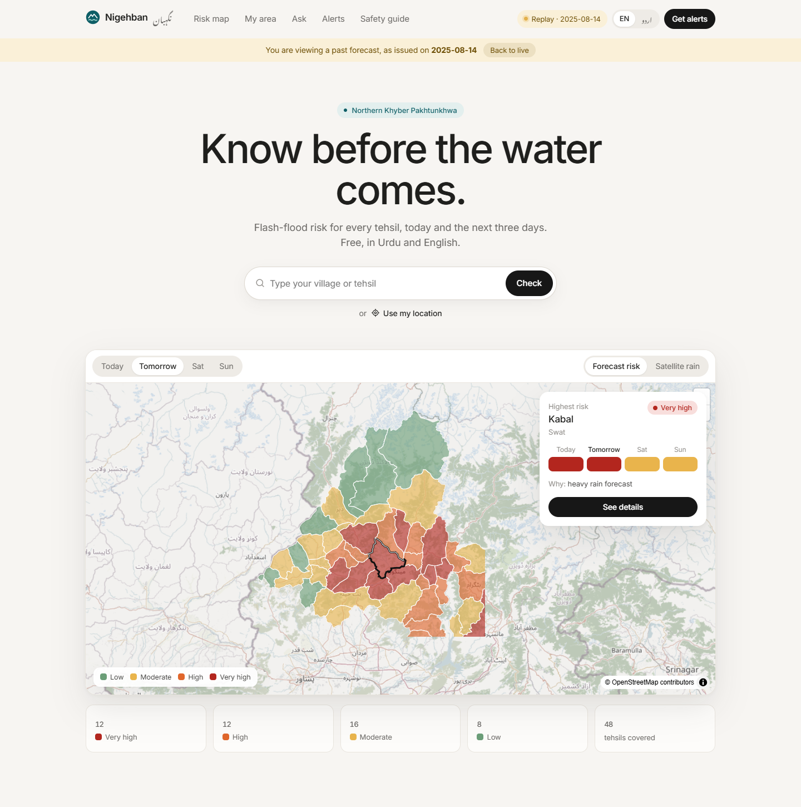
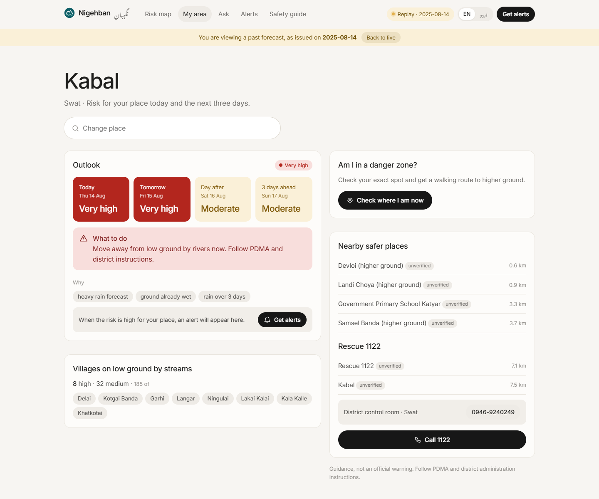
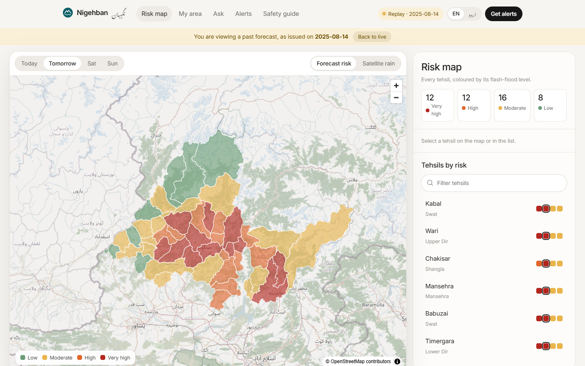
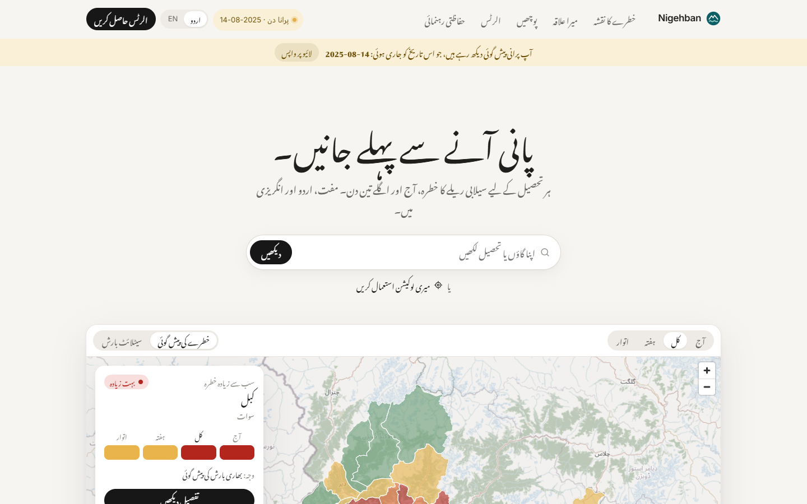
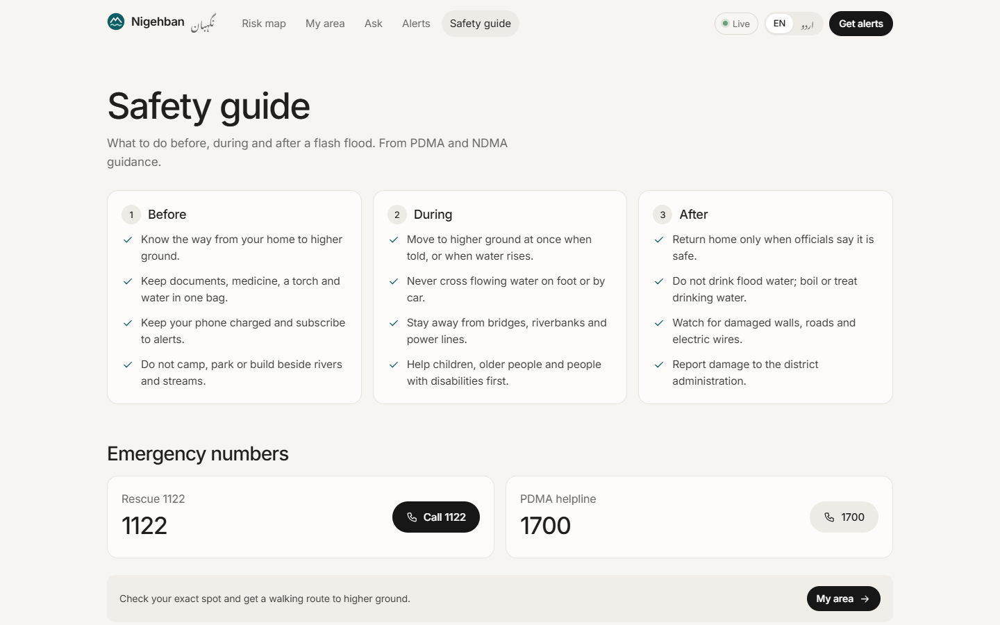
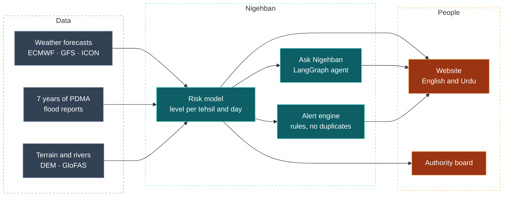

<div align="center">

# Nigehban · نگہبان

**Flash-flood early warning for northern Khyber Pakhtunkhwa, Pakistan**

Risk for every tehsil, up to 3 days ahead, in English and Urdu.

[](https://github.com/JawadGigyani/Nigehban/actions/workflows/ci.yml)


</div>



> [!NOTE]
> Nigehban is guidance, not an official warning. Risk is estimated per tehsil, not per house, and
> some floods will be missed. Always follow PDMA and district instructions.

## Highlights

- **Forecasts 3 days ahead** for 48 tehsils, from three international weather models.
- **Explains every level** in plain words: *heavy rain forecast*, *ground already wet*.
- **Beats a rain-threshold baseline**: caught 22 of 41 past floods, against 16.
- **Answers questions** in Urdu or English, citing its sources, and checks every answer in code.
- **Built for real use**: Urdu right-to-left, works on phones, encrypted contacts, replays of past floods.

## What you can do

| | |
|:--|:--|
| 🗺️ **See the risk** | A map of every tehsil, coloured Low to Very high, for today and the next 3 days. |
| 📍 **Check your place** | The level, the reasons, what to do, and named safer places nearby. |
| ⚠️ **Am I in danger?** | Checks if your spot is low ground by a river, with a walking route to higher ground. |
| 💬 **Ask Nigehban** | Questions answered only from Nigehban's data and official guidance, with Urdu voice. |
| 🔔 **Get alerts** | A message and an Urdu voice note in your inbox when your place turns High. |
| 🏛️ **Authority board** | Ranked tehsils, exposed villages, Rescue 1122 and ready-to-print advisories. |

## Screenshots

<table>
  <tr>
    <td width="50%"></td>
    <td width="50%"></td>
  </tr>
  <tr>
    <td align="center"><b>My area</b> · levels, advice, safer places</td>
    <td align="center"><b>Risk map</b> · every tehsil, ranked</td>
  </tr>
  <tr>
    <td width="50%"></td>
    <td width="50%"></td>
  </tr>
  <tr>
    <td align="center"><b>Urdu</b> · full right-to-left layout</td>
    <td align="center"><b>Safety guide</b> · before, during, after</td>
  </tr>
</table>

## Results

Tested on real archived forecasts for June–September 2024–2025. Each season was predicted by a model
that never saw it.

| Method | Floods caught (of 41) | Caught 3 days early |
|:--|:--:|:--:|
| **Nigehban** | **22** | **19** |
| Rain threshold | 16 | 14 |

Both at the same false-alarm rate (about 3 per tehsil per season). [How the model was chosen →](docs/MODEL.md)

## How it works



1. **Forecast.** Every few hours, rain forecasts are averaged for each tehsil.
2. **Score.** A model trained on past floods turns them into a probability, then a level.
3. **Act.** The level drives the map, the answers and the alerts. The AI writes the wording; it
   never sets the level.

[Full architecture →](docs/ARCHITECTURE.md)

## Tech stack

| Layer | Built with |
|:--|:--|
| **Website** | Next.js 15 · React 19 · TypeScript · MapLibre GL |
| **API** | Python 3.11 · FastAPI · Pydantic · SQLModel (SQLite or Postgres) |
| **Model** | scikit-learn (calibrated logistic regression) · pandas |
| **AI agent** | LangGraph · LangChain · Groq and Gemini |
| **Geospatial** | rasterio · pysheds · shapely · networkx (routing) |
| **Data** | Open-Meteo · NASA IMERG · Copernicus DEM · OpenStreetMap · PDMA KP |
| **Quality** | 197 backend tests (pytest) · 13 frontend tests (Vitest) · GitHub Actions |

## Quick start

You need **Python 3.11** and **Node.js 20**.

**1. Install**

```bash
python -m venv .venv
.venv/Scripts/pip install -e ".[dev]"      # macOS/Linux: .venv/bin/pip
cp .env.example .env
cd frontend && npm install && cd ..
```

**2. Run** (two terminals)

```bash
.venv/Scripts/python -m uvicorn backend.app.main:app --port 8000
```

```bash
cd frontend && npm run dev
```

**3. Open** http://localhost:3000, or jump to a real flood:
http://localhost:3000/?replay=2025-08-14

The maps and risk work with no keys. Add keys to `.env` to turn on more:

| To turn on | Add to `.env` |
|:--|:--|
| Ask Nigehban, alert text, advisories | `GROQ_API_KEY` or `GEMINI_API_KEY` |
| Alert sign-up | `NIGEHBAN_CONTACT_ENCRYPTION_KEY`, `NIGEHBAN_CONTACT_HASH_KEY` |
| Authority board | `NIGEHBAN_BOARD_PASSWORD` |
| Urdu voice | `NIGEHBAN_ELEVENLABS_API_KEY` |
| Satellite rain layer | `NIGEHBAN_EARTHDATA_TOKEN` |

Run tests with `python -m pytest -q` and `cd frontend && npm test`.
[All settings →](docs/CONFIGURATION.md)

## Documentation

| Guide | Read it to… |
|:--|:--|
| [User guide](docs/GUIDE.md) | Try every feature, step by step |
| [Architecture](docs/ARCHITECTURE.md) | See how the parts fit together |
| [Risk model](docs/MODEL.md) | Understand the data, model and results |
| [Data](docs/DATA.md) | Find sources and rebuild the data |
| [API](docs/API.md) | Call the backend |
| [Configuration](docs/CONFIGURATION.md) | Run it and set every option |

## Project structure

```
backend/     FastAPI app: risk model, agent, alerts, maps
frontend/    Next.js website and authority board
pipelines/   Scripts that build the data and train the model
data/        Reference tables (large and private data stays out of git)
reports/     Evaluation reports
tests/       Backend tests
docs/        Documentation
```

## Limits and next steps

- **Limits:** risk is per tehsil, not per house; about half of past floods were missed; small
  cloudbursts are the hardest case.
- **Next:** SMS, WhatsApp, push or a mobile app can plug into the alert engine as one class each;
  real river gauges and more flood labels would improve the model.

## License

Code is [MIT](LICENSE). Data keeps its source licences: OpenStreetMap under ODbL; GeoNames, WorldPop,
Open-Meteo and GloFAS under CC BY 4.0.

## Acknowledgements

Nigehban builds on ideas from **[flood-aware](https://github.com/Muhammad-Ilyas1408/flood-aware)** by
**Muhammad Ilyas** and **Abdullah Ahmad**, an earlier flood-awareness prototype. From it we took the
idea of a question-answering assistant grounded in official guidance, and four of the guidance
documents in the knowledge base: the PDMA KP summer hazards contingency plan, the National Disaster
Management Plan, the Swat disaster risk mapping, and the NIH flood guidelines. Thank you both.
