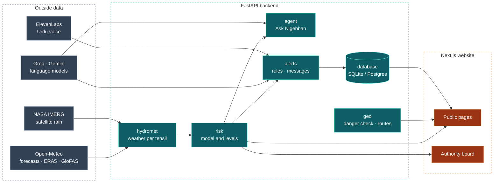
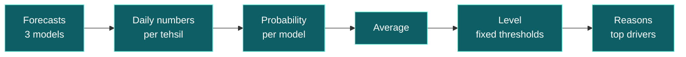
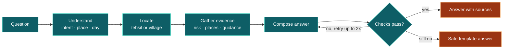

# Architecture

One Python API serves everything. The website calls it over HTTP. An alert job runs on a schedule.

## The parts

| Part | Folder | What it does |
|:--|:--|:--|
| **Hydromet** | `backend/app/hydromet/` | Fetches forecasts, turns them into daily numbers per tehsil, tracks rivers and satellite rain |
| **Risk** | `backend/app/risk/` | Scores each tehsil and day, picks the level, explains why |
| **Geo** | `backend/app/geo/` | Danger check from terrain, walking routes, Rescue 1122 contacts, Urdu place names |
| **Agent** | `backend/app/agent/` | Answers questions from evidence and checks each answer |
| **Knowledge** | `backend/app/knowledge/` | Searchable PDMA, NDMA and NIH guidance |
| **Alerts** | `backend/app/alerts/` | Alert rules, messages in three languages, voice, advisories |
| **LLM** | `backend/app/llm/` | Language-model access with key rotation and fallback |
| **API** | `backend/app/api/` | HTTP endpoints ([API reference](API.md)) |
| **Website** | `frontend/` | Public pages and the authority board |
| **Pipelines** | `pipelines/` | Offline jobs that build data and train the model ([Data](DATA.md)) |

## How a risk level is made

1. Forecasts from ECMWF, GFS and ICON are fetched for every 0.25° cell and averaged per tehsil.
2. Each model's numbers are scored separately; the three probabilities are averaged.
3. Fixed thresholds per lead day turn the probability into Low, Moderate, High or Very high.
4. The inputs that pushed the score up the most become the reasons shown to people.
5. A high river forecast (GloFAS) adds a river flag. It can trigger an alert but never lowers a level.

**Replays** use the forecasts exactly as they were issued on that day, so they never see the future.

## How an alert is sent

1. The alert job runs (`python -m pipelines.alerts.run_cycle`, or `POST /internal/run-cycle`).
2. It picks tehsils at **High or above within 2 days**, or with a river flag.
3. It skips tehsils nobody has subscribed to, and anything already sent.
4. A language model writes the message in English, Urdu and Roman Urdu. Code checks the level,
   place and date. If the check fails, a template is used.
5. The Urdu message becomes a voice note.
6. The alert lands in each subscriber's web inbox.

Other channels (SMS, WhatsApp, push, a mobile app) can be added as one class each in
`backend/app/alerts/channels.py`.

## How a question is answered

The checks: every cited source must exist, the stated level must match the model, and Urdu place names
come from a fixed table. Urdu answers go to Gemini first, which writes better Urdu.

## Key decisions

| Decision | Why |
|:--|:--|
| **Tehsil, not house** | The weather grid is about 25 km; per-house risk would claim precision the data doesn't support. |
| **Simple model** | With 89 flood days, tree models overfit. Logistic regression generalised best. |
| **Levels from thresholds, never the AI** | Warnings must be reproducible. The AI only writes words. |
| **Three weather models** | They disagree on local storms; the average is steadier. |
| **Satellite rain as a layer only** | It helps only after rain has fallen, so it can't forecast. |
| **Named safer places only** | Nobody can find "an unnamed building". |
| **Free services** | Runs without a budget; a pacer and caches stay inside free limits. |
